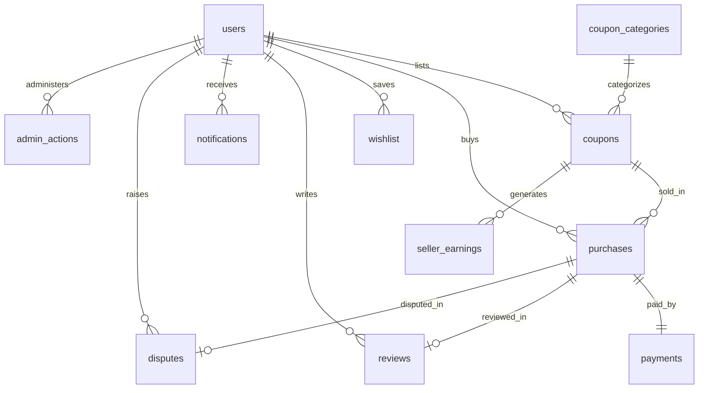

# CouponLoop – Turning Unused Coupons into Value

[](https://www.oracle.com/java/)
[](https://jakarta.ee/)
[](https://tomcat.apache.org/)
[](https://www.mysql.com/)
[](https://getbootstrap.com/)
[](LICENSE)

> A modern, responsive, full-stack digital coupon and voucher marketplace that empowers users to turn unused, transferable promotional vouchers into real earnings, while granting buyers instant access to discounted deals from top brands.

---

## 1. Project Overview

Every day, millions of digital coupons and vouchers are distributed through payment platforms like Google Pay, PhonePe, and Paytm, as well as e-commerce giants like Amazon, Swiggy, and Flipkart. A significant portion of these vouchers expire unused because the recipient does not need that particular service.

**CouponLoop** bridges this gap:
- **Sellers** list and monetize unused, transferable coupons before they expire.
- **Buyers** discover and purchase verified brand deals at steep discounts.
- **Merchants** see their promotional campaigns effectively redeemed by motivated shoppers.
- **Marketplace** operates sustainably on a standard 10% platform transaction commission.

> **Crucial Compliance Rule:** CouponLoop strictly differentiates between *promotional source labels* (e.g., Google Pay, PhonePe) and *legal transferability*. Account-bound cashback rewards, non-transferable personalized coupons, and restricted wallet credits are strictly rejected by the platform's eligibility engine.

---

## 2. Technology Stack

CouponLoop is built strictly following enterprise Java specifications without heavy modern frameworks (no Spring Boot, React, Angular, or Node.js runtime):

| Layer | Technologies Used |
|---|---|
| **Frontend** | HTML5, CSS3, JavaScript (ES6+ Fetch API), Bootstrap 5.3.3, Font Awesome 6.5.2, Chart.js 4.4.1 |
| **Backend** | Java 21 LTS, Jakarta EE 10 (`jakarta.servlet.*`, `jakarta.servlet.http.*`, Servlet 6.0) |
| **Database** | MySQL Server 8.0+ / 9.x via pure JDBC (`PreparedStatement`) |
| **Server Runtime** | Apache Tomcat 10.1.x |
| **Build & Packaging** | Apache Maven 3.9+ (`war` packaging) |
| **Serialization** | Google Gson 2.10.1 |
| **Security** | SHA-256 + cryptographic salt password hashing, Anti-Double-Spend Pessimistic Row Locking (`SELECT ... FOR UPDATE`), Session-based RBAC |

---

## 3. Architecture & MVC Project Structure

```
CouponProject/
├── pom.xml                                      # Maven project configuration
├── README.md                                    # Project documentation & setup manual
└── src/
    └── main/
        ├── java/com/couponloop/
        │   ├── config/
        │   │   ├── DBConnection.java            # JDBC connection manager with fallback
        │   │   └── AppConfig.java               # Global configuration constants
        │   ├── model/                           # Pure Java POJO domain models
        │   │   ├── User.java
        │   │   ├── Category.java
        │   │   ├── Coupon.java
        │   │   ├── Payment.java
        │   │   ├── Purchase.java
        │   │   ├── SellerEarning.java
        │   │   ├── Wishlist.java
        │   │   ├── Review.java
        │   │   ├── Notification.java
        │   │   ├── Dispute.java
        │   │   └── CouponReport.java
        │   ├── dao/                             # Data Access Objects (100% PreparedStatement)
        │   │   ├── UserDAO.java
        │   │   ├── CategoryDAO.java
        │   │   ├── CouponDAO.java
        │   │   ├── PurchaseDAO.java             # Atomic transaction & anti-double-spend lock
        │   │   ├── SellerEarningDAO.java
        │   │   ├── WishlistDAO.java
        │   │   ├── ReviewDAO.java
        │   │   ├── NotificationDAO.java
        │   │   ├── DisputeDAO.java
        │   │   └── AdminDAO.java
        │   ├── controller/                      # Jakarta REST-style Servlets
        │   │   ├── AuthServlet.java             # /api/auth/*
        │   │   ├── UserServlet.java             # /api/user/*
        │   │   ├── CouponServlet.java           # /api/coupons/*
        │   │   ├── SellerServlet.java           # /api/seller/*
        │   │   ├── BuyerServlet.java            # /api/buyer/*
        │   │   ├── PurchaseServlet.java         # /api/purchase/*
        │   │   ├── WishlistServlet.java         # /api/wishlist/*
        │   │   ├── ReviewServlet.java           # /api/reviews/*
        │   │   ├── DisputeServlet.java          # /api/disputes/*
        │   │   ├── NotificationServlet.java     # /api/notifications/*
        │   │   ├── CategoryServlet.java         # /api/category/*
        │   │   └── AdminServlet.java            # /api/admin/*
        │   ├── filter/
        │   │   ├── EncodingFilter.java          # UTF-8 & Security headers filter
        │   │   ├── AuthenticationFilter.java    # Protected route session gate
        │   │   └── AdminFilter.java             # Admin-only authorization barrier
        │   └── util/
        │       ├── PasswordUtil.java            # Salted SHA-256 password security
        │       ├── JsonUtil.java                # Gson JSON payload parsing & responses
        │       ├── ValidationUtil.java          # Input validation and XSS sanitizer
        │       └── SmartPricingUtil.java        # Algorithmic pricing suggestion engine
        ├── resources/
        │   ├── db.properties                    # Externalized DB connection credentials
        │   ├── schema.sql                       # 12-table relational MySQL schema
        │   └── sample_data.sql                  # Seed records (categories, coupons, users)
        └── webapp/
            ├── WEB-INF/
            │   └── web.xml                      # Deployment descriptor (Servlet 6.0)
            ├── assets/
            │   ├── css/
            │   │   └── style.css                # Custom theme (Purple & Blue startup aesthetic)
            │   └── js/
            │       ├── api.js                   # Unified Fetch client
            │       ├── app.js                   # State, toast, modal & wishlist handlers
            │       └── chart-analytics.js       # Chart.js visualization scripts
            ├── index.html                       # Modern landing page
            ├── browse.html                      # Marketplace catalog with live filtering
            ├── coupon-details.html              # Dedicated coupon showcase & checkout trigger
            ├── upload-coupon.html               # Seller listing studio with smart pricing
            ├── buyer-dashboard.html             # Unlocked voucher codes & transaction ledger
            ├── seller-dashboard.html            # Analytics, active listings, earnings & payouts
            ├── wishlist.html                    # Saved coupons manager
            ├── admin-dashboard.html             # Platform governance, moderation & disputes
            ├── login.html                       # Clean user sign-in page
            ├── register.html                    # User onboarding registration form
            ├── forgot-password.html             # Account recovery form
            ├── profile.html                     # Profile & UPI payout settings
            ├── about.html                       # Company background & mission
            ├── how-it-works.html                # Step-by-step marketplace guide
            ├── faq.html                         # Comprehensive user FAQ
            ├── contact.html                     # Customer support & inquiry form
            ├── terms.html                       # Terms of Service & transfer rules
            ├── privacy.html                     # Privacy policy
            └── refund-policy.html               # Dispute & buyer protection policy
```

---

## 4. Key Standout Features

### 1. Smart Pricing Suggestions
An automated algorithmic price calculator evaluates coupon value, remaining validity days, and historical brand demand to recommend the optimal selling price that maximizes the seller's profit while remaining attractive to buyers:
$$\text{Base Discount} = 65\% - 5\% \times \text{Brand Factor} - 5\% \times \text{Validity Factor}$$
The seller retains full freedom to accept, adjust, or override the suggestion.

### 2. Coupon Eligibility & Transferability Checker
Before a coupon goes live, the listing engine validates:
- Whether the code is account-locked or universal.
- Direct cashback rewards or personalized wallet credits are flagged and **rejected**.
- Expiration date is strictly in the future.
- Duplicate active or sold codes are blocked.

### 3. Expiry Urgency Reminders
Coupons approaching their end date display visual badges and automated notifications:
- **7 Days Remaining:** Blue reminder banner.
- **3 Days Remaining:** Amber warning badge.
- **1 Day Remaining:** Pulsing red emergency badge.
Expired coupons are automatically marked inactive during system startup.

### 4. Sandbox Payment Gateway & Anti-Double-Spend Engine
- Realistic multi-method payment modal supporting **UPI (Google Pay / PhonePe / Paytm)**, **Credit / Debit Cards**, and **Net Banking**.
- Includes a toggleable **Simulate Bank Failure** mode for robust testing of rejection workflows.
- Uses **Pessimistic Database Row Locking** (`SELECT status FROM coupons WHERE coupon_id = ? FOR UPDATE`) inside an isolated ACID transaction.
- Prevents two simultaneous buyers from purchasing the same voucher.
- Coupon codes are masked (`••••••••`) across all public browse endpoints and are revealed **strictly** after confirmed payment.
- Automatically calculates and splits the transaction into platform commission (10%) and seller net earnings (90%).

### 5. Verified Review & Dispute Resolution System
- Only buyers with a confirmed purchase record can rate and review a seller (1 to 5 stars + review comment).
- Buyers can flag invalid or already-redeemed coupons within the 24-hour guarantee window.
- Administrators review evidence, issue refunds, or suspend fraudulent sellers directly from the Admin Panel.

### 6. Seller Coupon Submission & Admin Approval System
- **Dynamic Database-Driven Marketplace:** All dummy/hardcoded coupons have been removed. Only real seller-uploaded and admin-approved coupons are visible to buyers.
- **Strict Duplicate Coupon Detection:** If a seller submits a coupon code that already exists on the platform or an identical brand and title, the submission is rejected with an HTTP 409 Conflict error.
- **Automatic `PENDING` Status:** New submissions are saved with `PENDING` status and hidden from the public catalog.
- **Seller Confirmation:** The seller receives the confirmation message: `"Your coupon has been submitted successfully. It is waiting for admin approval."`
- **Admin Dashboard Approval Management:** Administrators review pending vouchers with full seller details, original and selling prices, transferability flags, and issuer source.
  - **Approve:** Updates status to `APPROVED`, records admin ID and approval timestamp, notifies seller, and immediately publishes the coupon to the buyer marketplace.
  - **Reject:** Prompts for a rejection reason, updates status to `REJECTED`, stores the reason, notifies the seller, and keeps the coupon hidden from buyers.
  - Sellers can inspect the rejection reason directly from their Seller Dashboard.

---

## 5. Database Schema & Tables

The database name is **`couponloop_db`** containing 12 normalized relational tables:



1. **`users`**: User records, hashed passwords, roles (`BUYER`, `SELLER`, `ADMIN`), UPI payout ID, account status.
2. **`coupon_categories`**: Standardized catalog categories (Food, Shopping, Travel, Movies, Groceries, etc.).
3. **`coupons`**: Listing records, brand names, masked coupon codes, expiry dates, selling prices, transferability flags.
4. **`payments`**: Transaction records, payment method, gateway transaction IDs, payment status (`SUCCESS`, `FAILED`).
5. **`purchases`**: Successful orders linking buyer, coupon, and payment with revealed access timestamps.
6. **`seller_earnings`**: Accounting ledger with gross price, 10% commission, and 90% net seller payout.
7. **`wishlist`**: Saved items for registered buyers.
8. **`reviews`**: Verified purchase ratings (1 to 5 stars) and seller feedback.
9. **`notifications`**: In-app alert messages for sales, expiry alerts, disputes, and reviews.
10. **`disputes`**: Buyer conflict records, evidence notes, resolution state (`PENDING`, `RESOLVED`, `REFUNDED`).
11. **`coupon_reports`**: Community moderation flags for inaccurate or expired listings.
12. **`admin_actions`**: Administrative audit trail for user suspensions, listing takedowns, and dispute refunds.

---

## 6. Pre-Configured Test Accounts

All sample accounts are pre-seeded in `src/main/resources/sample_data.sql` with salted SHA-256 hashes:

| Role | Email Address | Password | Account Purpose |
|---|---|---|---|
| **Admin** | `admin@couponloop.com` | `Admin@123` | Full administrative control, user moderation, dispute resolution, analytics |
| **Seller** | `rahul.seller@gmail.com` | `Seller@123` | Active coupon seller with multiple listings, earnings, and payout tracking |
| **Buyer** | `priya.buyer@gmail.com` | `Buyer@123` | Active buyer with purchases, wishlist items, and review submissions |
| **General** | `anusha@couponloop.com` | `User@123` | Standard dual-role registered user ready for custom actions |

---

## 7. Setup & Installation Guide

### Prerequisites
- **Java Development Kit (JDK):** Version 17 or 21 LTS installed.
- **MySQL Server:** Version 8.0 or 9.x running on port `3306`.
- **Apache Tomcat:** Version 10.1.x (Jakarta EE 10 / Servlet 6.0 compatible).
- **Apache Maven:** Version 3.8+ (or Maven wrapper).
- **Eclipse IDE:** Eclipse IDE for Enterprise Java and Web Developers (2023-09 or newer).

---

### Step 1: Database Initialization
1. Open your MySQL client or command prompt:
   ```bash
   mysql -u root -p
   ```
2. Run the database schema script:
   ```bash
   mysql -u root -p < src/main/resources/schema.sql
   ```
3. Load the pre-configured sample data:
   ```bash
   mysql -u root -p < src/main/resources/sample_data.sql
   ```
4. Configure your database credentials in `src/main/resources/db.properties`:
   ```properties
   db.url=jdbc:mysql://localhost:3306/couponloop_db?useSSL=false&allowPublicKeyRetrieval=true&serverTimezone=UTC&characterEncoding=UTF-8
   db.username=root
   db.password=YourMySQLPassword
   ```

---

### Step 2: Build with Maven
Open a terminal in the project root (`d:\CouponProject`) and compile the application:

```bash
mvn clean package
```
This produces the self-contained deployment artifact:
`target/couponloop.war`

---

### Step 3: Deploy to Apache Tomcat 10.1 (Standalone)

1. Copy the generated `target/couponloop.war` into Tomcat's `webapps` directory:
   ```powershell
   Copy-Item -Path "target\couponloop.war" -Destination "C:\Program Files\Apache Software Foundation\Tomcat 10.1\webapps\couponloop.war" -Force
   ```
2. Start Apache Tomcat:
   ```powershell
   $env:JAVA_HOME = "C:\Program Files\Java\jdk-21"
   $env:CATALINA_HOME = "C:\Program Files\Apache Software Foundation\Tomcat 10.1"
   & "$env:CATALINA_HOME\bin\catalina.bat" run
   ```
3. Access CouponLoop in your web browser:
   **[http://localhost:8080/couponloop/](http://localhost:8080/couponloop/)**

---

### Step 4: Import into Eclipse Enterprise IDE

To develop, debug, and run CouponLoop directly from Eclipse:

1. **Launch Eclipse IDE:**
   - Open **Eclipse IDE for Enterprise Java and Web Developers**.
2. **Import the Maven Project:**
   - Click **File** > **Import...**
   - Select **Maven** > **Existing Maven Projects** and click **Next**.
   - Set the Root Directory to `d:\CouponProject`.
   - Ensure `pom.xml` is checked and click **Finish**.
   - Eclipse will resolve dependencies (Jakarta Servlet 6.0, MySQL Connector/J 8.3.0, Gson 2.10.1).
3. **Configure Apache Tomcat 10.1 Server in Eclipse:**
   - In the bottom pane, open the **Servers** tab (or go to **Window** > **Show View** > **Servers**).
   - Right-click and choose **New** > **Server**.
   - Expand **Apache** and select **Tomcat v10.1 Server**. Click **Next**.
   - Under **Tomcat installation directory**, browse to:
     `C:\Program Files\Apache Software Foundation\Tomcat 10.1`
   - Select your installed JRE / JDK (JDK 21 LTS).
   - In the **Add and Remove...** dialog, select **couponloop** and click **Add >**, then click **Finish**.
4. **Run the Project:**
   - Right-click the **couponloop** project in the Project Explorer.
   - Select **Run As** > **Run on Server**.
   - Choose the Tomcat 10.1 server and click **Finish**.
   - CouponLoop will automatically deploy and open in the internal or system browser at:
     `http://localhost:8080/couponloop/index.html`

---

## 8. REST-Style Servlet Endpoints Reference

All endpoints return standardized JSON structures:
`{ "success": true|false, "message": "...", "data": ... }`

| Method | Endpoint | Description | Access |
|---|---|---|---|
| `POST` | `/api/auth/register` | User account registration | Public |
| `POST` | `/api/auth/login` | Session login with salted password check | Public |
| `POST` | `/api/auth/logout` | Session invalidation | Authenticated |
| `GET` | `/api/auth/me` | Fetch active session user info | Authenticated |
| `GET` | `/api/coupons` | Search and filter active coupons (codes masked) | Public |
| `GET` | `/api/coupons/details?id={id}` | Get complete coupon details | Public |
| `GET` | `/api/coupons/categories` | Retrieve all 10 coupon categories | Public |
| `GET` | `/api/coupons/brands` | Retrieve distinct available brand names | Public |
| `POST` | `/api/coupons/smart-pricing` | Calculate dynamic smart pricing recommendation | Public / Seller |
| `POST` | `/api/coupons/eligibility-check`| Verify voucher transferability & rules | Public / Seller |
| `POST` | `/api/purchase/pay` | Atomic sandbox checkout & code unmasking | Authenticated (Buyer) |
| `GET` | `/api/buyer/purchases` | Retrieve purchased coupons with unlocked codes | Authenticated (Buyer) |
| `GET` | `/api/seller/dashboard` | Seller metrics, expiring listings, and stats | Authenticated (Seller) |
| `GET` | `/api/seller/my-coupons` | List all seller-owned vouchers | Authenticated (Seller) |
| `POST` | `/api/seller/upload` | Create a new coupon listing | Authenticated (Seller) |
| `POST` | `/api/seller/request-payout` | Request payout of accumulated net earnings | Authenticated (Seller) |
| `GET` | `/api/wishlist` | Fetch buyer wishlist | Authenticated |
| `POST` | `/api/wishlist/toggle` | Add or remove coupon from wishlist | Authenticated |
| `POST` | `/api/reviews` | Submit verified purchase rating (1-5 stars) | Authenticated (Buyer) |
| `POST` | `/api/disputes/raise` | Report defective voucher or request refund | Authenticated (Buyer) |
| `GET` | `/api/admin/overview` | Platform-wide volume, sales & users metrics | Admin |
| `GET` | `/api/admin/users` | List all registered users | Admin |
| `POST` | `/api/admin/toggle-user` | Suspend or reactivate user account | Admin |
| `POST` | `/api/admin/resolve-dispute` | Administer refund or dispute dismissal | Admin |

---

## 9. Security Implementations

1. **Password Encryption:** Passwords are never stored in plain text. A cryptographically generated random salt is combined with SHA-256 to produce secure stored hashes.
2. **SQL Injection Defense:** 100% of queries across all 10 DAOs utilize JDBC `PreparedStatement` with parameterized placeholders.
3. **Coupon Code Protection:** Unpurchased coupon codes are masked as `••••••••` at the DAO/Servlet level. The actual code is revealed exclusively upon confirmed payment to the verified purchaser.
4. **Anti-Double-Spend Concurrency Control:** Checkout operations utilize pessimistic row-level database locking (`FOR UPDATE`) wrapped inside an atomic transaction with `setAutoCommit(false)`, preventing race conditions between concurrent buyers.
5. **Session-Based RBAC:** Protected servlets validate session state (`AuthenticationFilter`) and verify role permissions (`AdminFilter`), rejecting unauthorized requests with HTTP 401 or 403.
6. **Input Sanitization:** Frontend forms and backend servlets sanitize all textual input against Cross-Site Scripting (XSS).

---

## 10. License & Attribution

Designed and developed for **CouponLoop – Turning Unused Coupons into Value**.  
Distributed under the **MIT License**.

Application live : https://smart-coupon-ql1v.onrender.com/seller-dashboard.html
